# ☁️ Manual de Infraestructura como Código (IaC) y Gestión de Costos
**Sistema**: Tacna SOC — Centro de Operaciones de Seguridad e Inteligencia de Negocios  
**Curso**: Inteligencia de Negocios 2026 — Universidad Privada de Tacna  
**Generado Automáticamente**: 2026-11-08

---

## 1. Topología de Infraestructura Cloud en GCP
Todos los recursos en la nube requeridos para la ejecución de Tacna SOC se gestionan de forma declarativa y reproducible mediante **Terraform (Google Provider v5+)** dentro de la carpeta `infra/`.

### Diagrama de Infraestructura Cloud e IaC:

```mermaid
graph TB
    %% ─────────────────────────────────────────────────────────────
    %% ZONA 1: CI/CD Y GITHUB ACTIONS
    %% ─────────────────────────────────────────────────────────────
    subgraph GITHUB["1. Entorno de Desarrollo y CI/CD (GitHub)"]
        direction TB
        REPO["Repositorio Git:<br/>si885-2026-ii-proyecto-group-5"]
        
        subgraph WF["GitHub Actions Workflows (.github/workflows/)"]
            WF_BUILD["ci-cd-deploy.yml<br/>(Lint, Build, Docker Build & Deploy)"]
            WF_DOCS["generate-docs.yml<br/>(Mermaid CLI & Auto Manuals Generator)"]
            WF_ETL["etl-pipeline.yml<br/>(Cron Diario & Manual Dispatch con Dry-Run)"]
        end

        IAC_CODE["Codigo Terraform (infra/)<br/>versions.tf, main.tf, variables.tf,<br/>storage.tf, bigquery.tf, cloud_run.tf"]
        INFRACOST["Infracost CLI (infracost.yml)<br/>Reporte Preventivo de Costos ($0.00/mes)"]

        REPO --> WF
        REPO --> IAC_CODE
        IAC_CODE --> INFRACOST
    end

    %% ─────────────────────────────────────────────────────────────
    %% ZONA 2: GOOGLE CLOUD PLATFORM INFRASTRUCTURE
    %% ─────────────────────────────────────────────────────────────
    subgraph GCP["2. Google Cloud Platform (Region: us-central1 - Always Free Tier)"]
        direction TB

        subgraph IAM["Seguridad e Identidad (IAM)"]
            SA_WEB["Service Account:<br/>tacna-soc-web-sa<br/>(Cloud Run Invoker, Minimal)"]
            SA_ETL["Service Account:<br/>tacna-soc-etl-sa<br/>(BigQuery Admin, Storage Admin)"]
        end

        subgraph AR["Registro de Contenedores (Artifact Registry)"]
            IMG_WEB["Docker Image:<br/>tacna-soc-web:latest<br/>(Node 20 Alpine Multi-stage)"]
            IMG_ETL["Docker Image:<br/>tacna-soc-etl:latest<br/>(Python 3.12 + Pandas)"]
        end

        subgraph COMPUTE["Computo Serverless (Cloud Run)"]
            CR_WEB["Cloud Run Service:<br/>tacna-soc-web<br/>(React 19 + Express API, Puerto 8080)<br/>Auto-scaling 0..10 instancias"]
            CR_JOB["Cloud Run Job:<br/>tacna-soc-etl<br/>(Contenedor de ejecucion batch)"]
        end

        subgraph SCHED["Orquestacion de Tiempos (Cloud Scheduler)"]
            SCHEDULER["Cloud Scheduler:<br/>tacna-soc-etl-daily<br/>(cron: '0 2 * * *' - 02:00 UTC)"]
        end

        subgraph STORAGE["Almacenamiento Masivo (Data Lake)"]
            GCS_BUCKET["Cloud Storage (GCS):<br/>gs://tacna-soc-raw-data-lake<br/>(Archivos Raw JSON / Parquet)"]
        end

        subgraph DWH["Data Warehouse Analitico (BigQuery)"]
            BQ_DATASET["BigQuery Dataset:<br/>tacna_soc_dwh<br/>(Particionado diario + Clustering)"]
            BQ_TABLES["Tablas Estrella:<br/>dim_time, dim_websites, dim_vulnerabilities<br/>fact_evaluations, fact_findings"]
            BQ_DATASET --- BQ_TABLES
        end

        %% RELACIONES INTERNAS GCP
        SCHEDULER ==>|Invoca HTTP OIDC| CR_JOB
        CR_JOB ==>|Escribe JSON Crudo| GCS_BUCKET
        CR_JOB ==>|Merge / Append Datos| BQ_DATASET
        CR_WEB -. Consulta Analitica .-> BQ_DATASET
        SA_WEB -. Asignada a .-> CR_WEB
        SA_ETL -. Asignada a .-> CR_JOB
    end

    %% ─────────────────────────────────────────────────────────────
    %% ZONA 3: CLIENTES Y USUARIOS
    %% ─────────────────────────────────────────────────────────────
    subgraph CLIENTS["3. Clientes y Actores SOC"]
        direction LR
        USER["Analistas SOC y Auditores<br/>(Navegador Web / HTTPS)"]
        PUBLIC_URL["URL Cloud Run Publica<br/>(https://tacna-soc-web-*.run.app)"]
        USER --> PUBLIC_URL
        PUBLIC_URL --> CR_WEB
    end

    %% CONEXION CI/CD A GCP
    WF_BUILD ==>|1. Compila y Sube Docker| AR
    WF_BUILD ==>|2. Despliega Version| CR_WEB
    IAC_CODE ==>|Terraform Apply| GCP

    %% ESTILOS
    classDef ghStyle fill:#181717,stroke:#6e7681,stroke-width:2px,color:#ffffff;
    classDef gcpCompute fill:#0c4a6e,stroke:#38bdf8,stroke-width:2px,color:#ffffff;
    classDef gcpStorage fill:#1e1b4b,stroke:#818cf8,stroke-width:2px,color:#ffffff;
    classDef gcpDwh fill:#064e3b,stroke:#34d399,stroke-width:2px,color:#ffffff;
    classDef gcpSched fill:#581c87,stroke:#c084fc,stroke-width:2px,color:#ffffff;

    class REPO,WF,WF_BUILD,WF_DOCS,WF_ETL,IAC_CODE,INFRACOST ghStyle;
    class CR_WEB,CR_JOB,IMG_WEB,IMG_ETL gcpCompute;
    class GCS_BUCKET gcpStorage;
    class BQ_DATASET,BQ_TABLES gcpDwh;
    class SCHEDULER,SA_WEB,SA_ETL gcpSched;

```


---

## 2. Inventario de Recursos Aprovisionados con Terraform

| Recurso Terraform | Identificador GCP | Propósito Arquitectónico | Free Tier / SLA |
|---|---|---|---|
| `google_storage_bucket` | `tacna-soc-raw-data-lake` | Bucket multirregional para el Data Lake Raw de extracciones JSON/Parquet | 5 GB/mes incluidos gratis |
| `google_bigquery_dataset` | `tacna_soc_dwh` | Data Warehouse analítico con particionamiento y clustering | 10 GB almacenamiento y 1 TB consultas/mes gratis |
| `google_cloud_run_v2_service` | `tacna-soc-web` | Aplicación web unificada (React 19 + Express API) con auto-escalado 0..10 | 2 millones de peticiones y 180k vCPU-s gratis |
| `google_cloud_run_v2_job` | `tacna-soc-etl` | Tarea serverless que ejecuta el contenedor Python de extracción y carga | Ejecución batch bajo demanda sin costo ocioso |
| `google_cloud_scheduler_job` | `tacna-soc-etl-daily` | Disparador programado cron (`0 2 * * *`) para el Cloud Run Job | Hasta 3 trabajos cron mensuales 100% gratuitos |
| `google_service_account` | `tacna-soc-web-sa`, `tacna-soc-etl-sa` | Cuentas de servicio con privilegios mínimos (Least Privilege) | Seguridad nativa IAM sin llaves estáticas |

---

## 3. Reporte Preventivo de Costos Mensuales (Infracost)

# Reporte de Estimación de Costos Cloud (IaC & Infracost)
> **Proyecto**: Tacna SOC — Centro de Operaciones de Seguridad & Inteligencia de Negocios  
> **Fecha de Emisión**: Noviembre 2026  
> **Herramienta de Análisis**: Infracost v0.10+ / GCP Pricing Calculator  
> **Infraestructura Evaluada**: Data Lake Raw (GCS), Data Warehouse (BigQuery), Pipeline ETL Serverless (Cloud Run Jobs) y Automatización (Cloud Scheduler).

---

## 1. Resumen Ejecutivo

El presente informe detalla el análisis de costos mensuales proyectados para la arquitectura cloud del proyecto **Tacna SOC**, aprovisionada mediante los módulos declarativos de Terraform ubicados en [`infra/`](file:///C:/Users/W10/Desktop/si885-2026-ii-si885-2026-ii-proyecto-group-5-main%20(1)/infra).

La solución ha sido intencionalmente diseñada para operar **dentro del Always Free Tier de Google Cloud Platform (GCP)** bajo la región por defecto `us-central1`, permitiendo sostener la infraestructura de inteligencia de negocios con un costo de **$0.00 a $0.05 USD mensuales**, mientras se mantiene la alternativa regional de baja latencia en `southamerica-west1` (Santiago de Chile) documentada para escenarios de producción estricta.

```
+-----------------------------------------------------------------------------------------+
|                              RESUMEN GENERAL DE COSTOS                                  |
+--------------------------+------------------------------+-------------------------------+
| Región de Despliegue     | us-central1 (Iowa, USA)      | southamerica-west1 (Santiago) |
+--------------------------+------------------------------+-------------------------------+
| Enfoque Operativo        | Free Tier Máximo (Costo $0)  | Mínima Latencia para Tacna    |
| Latencia RTT estimada    | ~120 - 145 ms (Aceptable ETL)| ~35 - 55 ms (Excelente)      |
| Costo Mensual Estimado   | $0.00 - $0.05 USD / mes      | $0.85 - $2.40 USD / mes       |
+--------------------------+------------------------------+-------------------------------+
```

---

## 2. Inventario de Componentes y Modelo de Consumo

El dimensionamiento se basa en el monitoreo continuo de **150 activos institucionales** de Tacna, escaneos diarios acumulativos y retención histórica de 365 días:

| Componente Cloud | Recurso Terraform | Métrica de Consumo Mensual | Cobertura en GCP Free Tier |
|---|---|---|---|
| **Google BigQuery (Storage)** | `google_bigquery_dataset.dwh` + 5 tablas | ~1.2 GB comprimidos (Capacitor) en el 1er año | **10 GB gratuitos** al mes (100% cubierto) |
| **Google BigQuery (Queries)** | Consultas OLAP de los 6 Reportes BI | ~45 GB escaneados / mes (con partición) | **1 TB gratuito** de consultas / mes (100% cubierto) |
| **Cloud Storage (Raw Lake)** | `google_storage_bucket.raw_lake` | ~500 MB nuevos / mes (~6 GB/año) con Nearline | **5 GB gratuitos** Standard Storage en `us-central1` |
| **Cloud Run Jobs (ETL)** | `google_cloud_run_v2_job.etl_job` | 30 ejecuciones/mes de 45 segundos (1 vCPU, 512 MB) | **180,000 vCPU-seg** y **360,000 GiB-seg** gratis |
| **Cloud Scheduler (Cron)** | `google_cloud_scheduler_job.etl_daily_cron` | 1 tarea activa disparada 30 veces al mes | **3 tareas gratuitas** por cuenta de facturación |

---

## 3. Desglose Detallado por Servicio y Región

### 3.1 Escenario A: Región `us-central1` (Configuración por Defecto en `variables.tf`)

Esta región califica para el programa **GCP Always Free Tier**:

1. **Google BigQuery**:
   - Almacenamiento activo (Active Storage): 1.2 GB almacenados. Cuota gratuita = 10 GB. Costo = **$0.00 USD**.
   - Procesamiento de consultas (Analysis Queries): 45 GB procesados. Cuota gratuita = 1,024 GB (1 TB). Costo = **$0.00 USD**.
2. **Google Cloud Storage (Data Lake Raw)**:
   - Almacenamiento Standard: Primeros 5 GB son gratuitos.
   - Excedente proyectado mes 12 (1.0 GB @ $0.020/GB): **$0.02 USD**.
   - Operaciones Clase A (escrituras/listados: ~3,000 req): Gratuitas en free tier.
   - Operaciones Clase B (lecturas: ~10,000 req): Gratuitas en free tier.
3. **Google Cloud Run Jobs (Pipeline ETL)**:
   - Tiempo de CPU: 30 ejecuciones × 45 seg = 1,350 segundos de vCPU (Límite gratuito: 180,000 seg). Costo = **$0.00 USD**.
   - Memoria: 1,350 seg × 0.5 GiB = 675 GiB-segundos (Límite gratuito: 360,000 GiB-seg). Costo = **$0.00 USD**.
   - Peticiones: 30 invocaciones (Límite gratuito: 2,000,000 req). Costo = **$0.00 USD**.
4. **Google Cloud Scheduler**:
   - 1 tarea programada. Cuota gratuita = hasta 3 tareas al mes. Costo = **$0.00 USD**.

> **Subtotal Mensual Estimado en `us-central1`**: **$0.00 - $0.02 USD / mes**.

---

### 3.2 Escenario B: Región `southamerica-west1` (Santiago de Chile — Baja Latencia)

En caso de que las políticas de soberanía de datos o gobernanza institucional exijan almacenar los datos en Sudamérica:

1. **Google BigQuery**:
   - El almacenamiento y procesamiento computacional gozan del Free Tier global (10 GB y 1 TB). Costo = **$0.00 USD**.
2. **Google Cloud Storage**:
   - La cuota de 5 GB gratuitos aplica exclusivamente a regiones de EE.UU. (`us-central1`, `us-east1`, `us-west1`).
   - Almacenamiento Standard en Santiago ($0.029 por GB/mes): 6 GB promedio × $0.029 = **$0.17 USD / mes**.
   - Operaciones Clase A en Santiago: ~3,000 ops × $0.05 / 10,000 = **$0.02 USD / mes**.
3. **Google Cloud Run Jobs**:
   - Cómputo en Santiago (tarifa Tier 2: ~$0.000030 por vCPU-seg): 1,350 seg × $0.000030 = **$0.04 USD / mes**.
4. **Red y Tráfico Saliente (Egress a Perú)**:
   - Tráfico de sincronización de reportes hacia analistas locales: ~5 GB / mes @ $0.12/GB = **$0.60 USD / mes**.

> **Subtotal Mensual Estimado en `southamerica-west1`**: **$0.85 - $1.40 USD / mes**.

---

## 4. Técnicas de Optimización de Costos Aplicadas en el Código

En la implementación de Terraform ([`infra/`](file:///C:/Users/W10/Desktop/si885-2026-ii-si885-2026-ii-proyecto-group-5-main%20(1)/infra)) y el DDL SQL ([`etl/sql/dwh_star_schema.sql`](file:///C:/Users/W10/Desktop/si885-2026-ii-si885-2026-ii-proyecto-group-5-main%20(1)/etl/sql/dwh_star_schema.sql)) se incorporaron 4 mecanismos de ahorro automático:

1. **Particionamiento Diario en BigQuery (`PARTITION BY DATE(evaluated_at)`)**:
   - Permite que las consultas de los reportes por Año, Mes y Día solo lean las particiones requeridas, reduciendo el volumen de bytes escaneados en más de un **85%** respecto a tablas planas.
2. **Clustering Multicolumna (`CLUSTER BY score, target_domain`, `severity, type`)**:
   - Agrupa físicamente los bloques de almacenamiento por severidad y dominio, optimizando los filtros más utilizados en el SOC sin costo adicional.
3. **Políticas de Ciclo de Vida en Cloud Storage (`lifecycle_rule`)**:
   - Transiciona automáticamente los archivos raw a almacenamiento `NEARLINE` a los 30 días y `COLDLINE` a los 90 días, reduciendo el costo de almacenamiento histórico en hasta un **75%**.
4. **Dimensionamiento Ajustado en Cloud Run (`cpu = 1000m`, `memory = 512Mi`)**:
   - Al tratarse de un Job por lotes (Batch) que procesa deltas incrementales, 512 MB de memoria son más que suficientes y quedan 100% absorbidos por la capa gratuita.

---

## 5. Instrucciones de Verificación con Infracost CLI

Para reproducir este análisis en una estación de trabajo con Infracost instalado:

```bash
# 1. Configurar clave de API de Infracost (gratuita)
infracost configure set api_key <TU_INFRACOST_API_KEY>

# 2. Ejecutar desglose detallado sobre la carpeta infra/
infracost breakdown --config-file infracost.yml

# 3. Generar comparativa contra el estado actual
infracost diff --config-file infracost.yml
```


---

## 4. Guía de Despliegue con Terraform

### 4.1. Requisitos Previos:
- Google Cloud SDK (`gcloud`) autenticado con `gcloud auth application-default login`.
- Terraform CLI v1.5.0 o superior instalado.
- Proyecto GCP creado con facturación habilitada.

### 4.2. Comandos de Ejecución:
```bash
# 1. Ingresar a la carpeta de infraestructura
cd infra

# 2. Configurar variables de entorno
cp terraform.tfvars.example terraform.tfvars
# Editar terraform.tfvars con su gcp_project_id

# 3. Inicializar módulos y proveedores
terraform init

# 4. Planificar y validar cambios
terraform plan -out=tfplan

# 5. Aplicar la infraestructura en GCP
terraform apply tfplan
```
