# 🚀 Manual de Operación, Despliegue y Automatización CI/CD
**Sistema**: Tacna SOC — Centro de Operaciones de Seguridad e Inteligencia de Negocios  
**Curso**: Inteligencia de Negocios 2026 — Universidad Privada de Tacna  
**Generado Automáticamente**: 2026-11-08

---

## 1. Arquitectura de Pipelines CI/CD (GitHub Actions)

El repositorio incorpora 3 flujos de trabajo automatizados en `.github/workflows/`:

1. **`ci-cd-deploy.yml` (Integración y Despliegue Continuo)**:
   - Valida el tipado estricto con TypeScript (`tsc --noEmit`).
   - Compila la aplicación frontend con Vite (`npm run build`).
   - Construye la imagen de producción Docker multi-stage.
   - Si existen los secretos `GCP_PROJECT_ID` y `GCP_SA_KEY`, despliega a Google Cloud Run; si no, finaliza exitosamente validando el artefacto compilado.
2. **`generate-docs.yml` (Documentación y Diagramas como Código)**:
   - Compila los diagramas Mermaid (`docs/diagrams/*.mmd`) a formato SVG/PNG mediante `@mermaid-js/mermaid-cli`.
   - Ejecuta este script (`scripts/generate-manuals.mjs`) para actualizar los manuales técnicos.
   - Genera artefactos descargables del flujo y realiza auto-commit de los cambios en el repositorio.
3. **`etl-pipeline.yml` (Orquestación Híbrida del ETL)**:
   - Se ejecuta diariamente vía cron (`0 2 * * *`) o bajo demanda con `workflow_dispatch`.
   - Ejecuta `etl/main.py` con soporte automático de fallback (`--dry-run`) si no hay credenciales activas.
   - Sube como artefacto los datasets generados para el Data Lake y el Esquema Estrella.

---

## 2. Diagrama de Secuencia del Proceso ETL Automatizado

```mermaid
sequenceDiagram
    autonumber
    title Tacna SOC - Proceso ETL Automatizado Periodico (Extract, Transform, Load)

    actor Admin as Administrador / DevOps
    participant Cron as Cloud Scheduler (GCP)
    participant Runner as Cloud Run Job (Python ETL)
    participant OLTP as Supabase PostgreSQL
    participant Lake as Cloud Storage (Data Lake)
    participant DWH as Google BigQuery (DWH)
    participant Audit as Bitacora de Auditoria

    %% FASE DE DISPARO
    alt Disparo Programado (Diario 02:00 UTC)
        Cron->>Runner: Trigger via Cloud Scheduler HTTP POST
    else Disparo Manual / CI-CD
        Admin->>Runner: Workflow Dispatch / CLI con --dry-run
    end

    activate Runner
    Runner->>Audit: Registrar inicio de lote ETL (run_id, timestamp)

    %% FASE EXTRACT
    rect rgb(20, 30, 50)
        note over Runner,OLTP: FASE 1: EXTRACT (Extraccion Incremental)
        Runner->>Runner: Consultar marca de agua previa (watermark TIMESTAMPTZ)
        Runner->>OLTP: SELECT * FROM websites, evaluations, findings, analyses WHERE updated_at >= watermark
        alt Conexion Supabase Activa
            OLTP-->>Runner: Devolver registros operacionales incrementales (JSON)
        else Fallback / Demostracion Offline (--dry-run)
            Runner->>Runner: Cargar dataset semilla homologado multi-anual (2025-2026)
        end
    end

    %% FASE TRANSFORM
    rect rgb(30, 20, 50)
        note over Runner: FASE 2: TRANSFORM (Limpieza y Modelo Dimensional Estrella)
        Runner->>Runner: 1. Limpieza y validacion de tipos (TIMESTAMPTZ, integers, URLs)
        Runner->>Runner: 2. Generar dim_time (date_key YYYYMMDD, ano, mes, dia, trimestre, semestre)
        Runner->>Runner: 3. Normalizar dim_websites (surrogate key, sector regional, estado)
        Runner->>Runner: 4. Normalizar dim_vulnerabilities (surrogate key, cwe, cve, OWASP Top 10)
        Runner->>Runner: 5. Construir fact_evaluations (FKs dimensionales, metricas de score y duracion)
        Runner->>Runner: 6. Construir fact_findings (FKs dimensionales, severidad, estado remediacion)
    end

    %% FASE LOAD
    rect rgb(10, 40, 30)
        note over Runner,DWH: FASE 3: LOAD (Carga Dual: Lake Inmutable + DWH Estrella)
        
        %% Carga Lake
        Runner->>Lake: PUT gs://tacna-soc-raw-data-lake/raw/year=YYYY/month=MM/batch.json
        Lake-->>Runner: 200 OK (Data Lake Crudo Respaldado)

        %% Carga DWH
        Runner->>DWH: MERGE INTO dim_websites, dim_vulnerabilities, dim_time
        Runner->>DWH: INSERT INTO fact_evaluations, fact_findings (Particionado diario)
        DWH-->>Runner: Operacion DWH Exitosa (Tablas estrella actualizadas)
    end

    %% MODO DEMO / EXPORT LOCAL
    opt Si modo es --dry-run o entorno local
        Runner->>Runner: Exportar archivos locales CSV y JSON en etl/output/star_schema/
    end

    %% CIERRE Y AUDITORIA
    Runner->>Audit: Registrar fin exitoso de ejecucion, volumen de filas y nuevo watermark
    Runner-->>Cron: 200 OK - Job Terminado Exitosamente
    deactivate Runner

```



---

## 3. Instrucciones de Operación Local y Modo Demo

### 3.1. Ejecución del Frontend y Backend en Desarrollo:
```bash
# 1. Instalar dependencias
cd tacna-soc
npm install

# 2. Iniciar servidor de desarrollo Vite + Express
npm run dev
# Abrir en http://localhost:3000
```

### 3.2. Compilación y Servidor de Producción:
```bash
cd tacna-soc
npm run build
npm start
# Servidor Express activo en http://localhost:8080 (sirviendo dist/)
```

### 3.3. Ejecución del Pipeline ETL en Modo Demo Local:
```bash
# Ejecutar pipeline ETL con extracción, transformación estrella y guardado local
python etl/main.py --dry-run
# Los archivos generados se ubican en etl/output/star_schema/ y etl/output/raw/
```

---

## 4. Configuración de Secretos en GitHub Actions

Para habilitar el despliegue automático a Google Cloud Run, configure los siguientes secretos en el repositorio GitHub (`Settings > Secrets and variables > Actions`):

- `GCP_PROJECT_ID`: Identificador único del proyecto en Google Cloud.
- `GCP_SA_KEY`: Llave privada JSON de la cuenta de servicio con roles `roles/run.admin` y `roles/storage.admin`.
- `GEMINI_API_KEY` (Opcional): Clave para el motor de diagnóstico SOC de Google Gemini AI.
- `VITE_SUPABASE_URL` y `VITE_SUPABASE_ANON_KEY`: Parámetros de conexión a la base de datos Supabase.
