# 🏛️ Manual Técnico de Arquitectura Data Warehouse & Data Lake
**Sistema**: Tacna SOC — Centro de Operaciones de Seguridad e Inteligencia de Negocios  
**Curso**: Inteligencia de Negocios 2026 — Universidad Privada de Tacna  
**Generado Automáticamente**: 2026-11-08

---

## 1. Resumen Ejecutivo de la Arquitectura
La arquitectura de datos de Tacna SOC implementa un patrón **Modern Data Stack** desacoplado en la nube de Google Cloud Platform (GCP). Su objetivo es transformar la telemetría operativa transaccional (OLTP) recolectada en tiempo real sobre los portales gubernamentales, de salud, educación y finanzas de la Región Tacna en un repositorio analítico multidimensional optimizado para la toma de decisiones estratégicas.

### Capas Principales del Ecosistema:
1. **Capa Transaccional (OLTP - Supabase PostgreSQL)**: Almacena las entidades operativas en 7 tablas relacionales con auditoría criptográfica SHA-256 e índices temporales `TIMESTAMPTZ`.
2. **Capa Data Lake Raw (Google Cloud Storage)**: Repositorio inmutable multirregional (`gs://tacna-soc-raw-data-lake`) donde se persisten extracciones históricas en formato crudo (JSON / Parquet).
3. **Capa Data Warehouse Analítico (Google BigQuery)**: Almacén serverless que implementa un **Esquema Estrella Canónico (Star Schema)** con particionamiento por día y clustering multidimensional.
4. **Capa de Inteligencia de Negocios (BI Web Suite)**: Módulo de 6 reportes analíticos dinámicos con filtros interactivos de **Año, Mes y Día**.

---

## 2. Diagrama de Arquitectura de Datos (C4 Container & Data Flow)

```mermaid
graph TD
    %% ─────────────────────────────────────────────────────────────
    %% CAPA 1: FUENTES TRANSACCIONALES (OLTP)
    %% ─────────────────────────────────────────────────────────────
    subgraph S1["1. Capa de Fuentes Operacionales (OLTP)"]
        direction TB
        SB["Supabase Managed PostgreSQL<br/>(Transactional Engine)"]
        T1["websites (Activos)"]
        T2["evaluations (Escaneos)"]
        T3["findings (Hallazgos CWE/CVE)"]
        T4["analyses (Diagnosticos SOC)"]
        T5["vulnerability_references"]
        T6["system_users"]
        T7["audit_logs (Trazabilidad SHA-256)"]
        SB --- T1
        SB --- T2
        SB --- T3
        SB --- T4
        SB --- T5
        SB --- T6
        SB --- T7
    end

    %% ─────────────────────────────────────────────────────────────
    %% CAPA 2: PROCESAMIENTO Y ORQUESTACION (ETL)
    %% ─────────────────────────────────────────────────────────────
    subgraph S2["2. Capa de Orquestacion y Procesamiento ETL"]
        direction TB
        CRON["Google Cloud Scheduler<br/>(cron: 0 2 * * * - 02:00 UTC)"]
        TRIGGER["Cloud Run Job Invoker<br/>(Service Account IAM)"]
        JOB["Google Cloud Run Job: tacna-soc-etl<br/>(Python 3.12 + Pandas Engine)"]
        EXTRACT["Extractor Incremental<br/>(TIMESTAMPTZ Watermark)"]
        TRANSFORM["Transformador Dimensional<br/>(Star Schema Builder)"]

        CRON --> TRIGGER --> JOB
        JOB --> EXTRACT --> TRANSFORM
    end

    %% ─────────────────────────────────────────────────────────────
    %% CAPA 3: DATA LAKE (RAW STORAGE)
    %% ─────────────────────────────────────────────────────────────
    subgraph S3["3. Capa Data Lake Raw (Google Cloud Storage)"]
        direction TB
        GCS["Bucket: gs://tacna-soc-raw-data-lake<br/>(Standard Storage / Multi-region)"]
        F_RAW["Respaldo Crudo JSON / Parquet<br/>/raw/year=YYYY/month=MM/day=DD/"]
        GCS --- F_RAW
    end

    %% ─────────────────────────────────────────────────────────────
    %% CAPA 4: DATA WAREHOUSE (BIGQUERY STAR SCHEMA)
    %% ─────────────────────────────────────────────────────────────
    subgraph S4["4. Capa Data Warehouse Analitico (BigQuery)"]
        direction TB
        DWH["Dataset: tacna_soc_dwh<br/>(Google BigQuery Serverless)"]
        
        subgraph DIM["Tablas Dimensionales"]
            D_TIME["dim_time<br/>(PK: date_key)"]
            D_WEB["dim_websites<br/>(PK: website_key)"]
            D_VULN["dim_vulnerabilities<br/>(PK: vulnerability_key)"]
        end

        subgraph FACT["Tablas de Hechos"]
            F_EVAL["fact_evaluations<br/>(Particion: evaluation_date)<br/>(Cluster: sector, grade)"]
            F_FIND["fact_findings<br/>(Particion: finding_date)<br/>(Cluster: severity, category)"]
        end

        DWH --- DIM
        DWH --- FACT
        F_EVAL -. FK .-> D_TIME
        F_EVAL -. FK .-> D_WEB
        F_FIND -. FK .-> D_TIME
        F_FIND -. FK .-> D_WEB
        F_FIND -. FK .-> D_VULN
    end

    %% ─────────────────────────────────────────────────────────────
    %% CAPA 5: CONSUMO E INTELIGENCIA DE NEGOCIOS (BI)
    %% ─────────────────────────────────────────────────────────────
    subgraph S5["5. Capa de Presentacion e Inteligencia de Negocios (BI)"]
        direction TB
        APP["Tacna SOC Web App<br/>(React 19 + Express en Cloud Run)"]
        F_BAR["Barra de Filtros Multidimensional:<br/>Ano (2025/2026) | Mes (01-12) | Dia (01-31) | Sector"]
        
        R1["Reporte 1: Tendencia Historica de Postura"]
        R2["Reporte 2: Matriz de Severidad"]
        R3["Reporte 3: Ranking de Exposicion Regional"]
        R4["Reporte 4: Top CVEs y OWASP Top 10"]
        R5["Reporte 5: Eficacia y MTTR"]
        R6["Reporte 6: Bitacora de Auditoria SOC"]
        
        APP --> F_BAR
        F_BAR --> R1
        F_BAR --> R2
        F_BAR --> R3
        F_BAR --> R4
        F_BAR --> R5
        F_BAR --> R6
    end

    %% CONEXIONES INTER-CAPAS
    SB ==>|1. Extraccion incremental REST/Postgres| EXTRACT
    TRANSFORM ==>|2. Carga Inmutable Cruda| GCS
    TRANSFORM ==>|3. Carga Dimensional Merge/Append| DWH
    DWH ==>|4. Consultas Analiticas / Exportaciones| APP

    %% ESTILOS
    classDef sourceStyle fill:#1e293b,stroke:#38bdf8,stroke-width:2px,color:#f8fafc;
    classDef etlStyle fill:#0f172a,stroke:#a855f7,stroke-width:2px,color:#f8fafc;
    classDef lakeStyle fill:#1e1b4b,stroke:#6366f1,stroke-width:2px,color:#f8fafc;
    classDef dwhStyle fill:#064e3b,stroke:#10b981,stroke-width:2px,color:#f8fafc;
    classDef biStyle fill:#701a75,stroke:#f43f5e,stroke-width:2px,color:#f8fafc;

    class SB,T1,T2,T3,T4,T5,T6,T7 sourceStyle;
    class CRON,TRIGGER,JOB,EXTRACT,TRANSFORM etlStyle;
    class GCS,F_RAW lakeStyle;
    class DWH,D_TIME,D_WEB,D_VULN,F_EVAL,F_FIND dwhStyle;
    class APP,F_BAR,R1,R2,R3,R4,R5,R6 biStyle;

```



---

## 3. Diccionario de Datos del Esquema Estrella (BigQuery)

El Data Warehouse reside en el dataset `tacna_soc_dwh` y se compone de 3 tablas dimensionales y 2 tablas de hechos:

### 3.1. Tablas Dimensionales (`dim_*`)

#### A. `dim_time` (Dimensión de Tiempo Canónica)
Permite la navegación jerárquica temporal sin requerir cómputo en tiempo de ejecución:
- **`date_key`** (INTEGER, PK): Clave subrogada numérica en formato `YYYYMMDD` (ej. `20260215`).
- **`full_date`** (DATE): Fecha calendario estándar.
- **`year`** (INTEGER): Año calendario (2025, 2026...).
- **`quarter`** (INTEGER): Trimestre (1 - 4).
- **`month`** (INTEGER): Número de mes (1 - 12).
- **`month_name`** (STRING): Nombre completo en español (Enero, Febrero...).
- **`day_of_month`** (INTEGER): Día del mes (1 - 31).
- **`day_of_week`** (INTEGER): Día de la semana (1 = Lunes, 7 = Domingo).
- **`day_name`** (STRING): Nombre del día (Lunes, Martes...).
- **`is_weekend`** (BOOLEAN): Indicador de fin de semana.
- **`semester`** (INTEGER): Semestre académico/financiero (1 o 2).

#### B. `dim_websites` (Dimensión de Activos Digitales Regionales)
- **`website_key`** (STRING, PK): Hash MD5 o UUID del activo.
- **`natural_id`** (STRING): Identificador operacional en Supabase.
- **`domain`** (STRING): Nombre de dominio analizado (ej. `regiontacna.gob.pe`).
- **`name`** (STRING): Nombre descriptivo de la entidad.
- **`institution_name`** (STRING): Razón social de la institución.
- **`sector`** (STRING): Clasificación sectorial (Gobierno, Salud, Educación, Finanzas, Comercio).
- **`ip_address`** (STRING): Dirección IP pública resuelta vía DNS.
- **`environment`** (STRING): Entorno (`Producción`, `Desarrollo`, `Staging`).
- **`status`** (STRING): Estado del activo (`Activo`, `Inactivo`, `Bajo Análisis`).

#### C. `dim_vulnerabilities` (Dimensión de Catálogo de Vulnerabilidades)
- **`vulnerability_key`** (STRING, PK): Clave dimensional subrogada.
- **`natural_id`** (STRING): Código normalizado (ej. `CWE-693`, `CVE-2024-21413`).
- **`name`** (STRING): Nombre técnico de la debilidad.
- **`cwe_code`** (STRING): Código del estándar MITRE CWE.
- **`owasp_category`** (STRING): Mapeo al estándar internacional OWASP Top 10 (2021).
- **`default_severity`** (STRING): Severidad estándar (CRITICAL, HIGH, MEDIUM, LOW).
- **`cvss_base_score`** (NUMERIC): Puntuación base según Common Vulnerability Scoring System v3.1.
- **`cvss_range`** (STRING): Rango cualitativo CVSS (`Crítico [9.0-10.0]`, `Alto [7.0-8.9]`...).

---

### 3.2. Tablas de Hechos (`fact_*`)

#### A. `fact_evaluations` (Hechos de Escaneos de Seguridad)
- **Particionamiento**: Diario sobre la columna `evaluation_date`.
- **Clustering**: `sector`, `security_grade`.
- **Métricas Clave**:
  - `security_score` (NUMERIC, 0-100): Calificación general de postura.
  - `response_time_ms` (INTEGER): Latencia del servicio en milisegundos.
  - `critical_count`, `high_count`, `medium_count`, `low_count`: Contadores de severidad.
  - `total_findings`: Conteo total de fallas detectadas.

#### B. `fact_findings` (Hechos de Vulnerabilidades Detectadas a Nivel Atómico)
- **Particionamiento**: Diario sobre la columna `finding_date`.
- **Clustering**: `severity`, `owasp_category`.
- **Métricas Clave**:
  - `cvss_score`: Puntuación CVSS del hallazgo específico.
  - `remediation_sla_days`: Plazo objetivo de resolución según norma (Crítica = 2 días, Alta = 7 días).
  - `days_open`: Días transcurridos sin mitigar.
  - `is_sla_breached`: Bandera de incumplimiento de SLA de seguridad.

---

## 4. Script DDL Maestro de BigQuery

A continuación se documenta el código DDL formal utilizado para aprovisionar el esquema en BigQuery:

```sql
-- ====================================================================
-- Google BigQuery DDL: Esquema Estrella (Star Schema) - Tacna SOC DWH
-- Dataset Objetivo: tacna_soc_dwh
-- Capa Analítica: Business Intelligence, Dashboarding y Auditoría
-- ====================================================================

-- 1. Dimensión de Tiempo (dim_time)
CREATE TABLE IF NOT EXISTS `tacna_soc_dwh.dim_time` (
  time_key INT64 NOT NULL OPTIONS(description="Clave subrogada formato YYYYMMDD"),
  calendar_date DATE NOT NULL OPTIONS(description="Fecha calendario real"),
  year INT64 NOT NULL OPTIONS(description="Año calendario (ej. 2025, 2026)"),
  quarter INT64 NOT NULL OPTIONS(description="Trimestre (1, 2, 3, 4)"),
  month INT64 NOT NULL OPTIONS(description="Mes numérico (1-12)"),
  month_name STRING NOT NULL OPTIONS(description="Nombre del mes en español"),
  day INT64 NOT NULL OPTIONS(description="Día del mes (1-31)"),
  day_of_week INT64 NOT NULL OPTIONS(description="Día de la semana (1=Domingo, 7=Sábado)"),
  day_name STRING NOT NULL OPTIONS(description="Nombre del día en español"),
  is_weekend BOOL NOT NULL OPTIONS(description="Indica si es sábado o domingo"),
  semester INT64 NOT NULL OPTIONS(description="Semestre calendario (1 o 2)")
)
PARTITION BY calendar_date
OPTIONS(
  description="Dimensión temporal conformada para análisis multidimensional OLAP por Año, Mes y Día",
  require_partition_filter=false
);

-- 2. Dimensión de Activos Web Institucionales (dim_websites)
CREATE TABLE IF NOT EXISTS `tacna_soc_dwh.dim_websites` (
  website_key INT64 NOT NULL OPTIONS(description="Clave subrogada autoincremental"),
  website_id STRING NOT NULL OPTIONS(description="ID natural del activo en Supabase (ej. site-1)"),
  name STRING NOT NULL OPTIONS(description="Nombre descriptivo del portal web"),
  institution STRING NOT NULL OPTIONS(description="Entidad pública o privada responsable"),
  category STRING NOT NULL OPTIONS(description="Sector: Gobierno, Educación, Salud, Finanzas"),
  url STRING NOT NULL OPTIONS(description="URL completa o FQDN del portal"),
  ip_address STRING OPTIONS(description="Dirección IPv4 del servidor perimetral"),
  status STRING NOT NULL OPTIONS(description="Estado de monitoreo: Activo o Inactivo"),
  current_risk_level STRING OPTIONS(description="Nivel de riesgo vigente: Crítico, Alto, Medio, Bajo"),
  current_risk_score FLOAT64 OPTIONS(description="Puntaje de riesgo cuantitativo (0.00 - 100.00)"),
  valid_from TIMESTAMP NOT NULL OPTIONS(description="Inicio de validez del registro SCD Tipo 2"),
  valid_to TIMESTAMP OPTIONS(description="Fin de validez del registro (NULL si es actual)"),
  is_current BOOL NOT NULL OPTIONS(description="Indica si es el registro vigente del activo")
)
CLUSTER BY category, status
OPTIONS(
  description="Dimensión de activos web perimetrales monitoreados en la región Tacna"
);

-- 3. Dimensión de Vulnerabilidades y Amenazas (dim_vulnerabilities)
CREATE TABLE IF NOT EXISTS `tacna_soc_dwh.dim_vulnerabilities` (
  vulnerability_key INT64 NOT NULL OPTIONS(description="Clave subrogada de la vulnerabilidad"),
  cve_id STRING NOT NULL OPTIONS(description="Identificador oficial NIST NVD (ej. CVE-2023-38408)"),
  name STRING NOT NULL OPTIONS(description="Título formal de la vulnerabilidad"),
  severity STRING NOT NULL OPTIONS(description="Severidad cualitativa: Crítica, Alta, Media, Baja"),
  cvss_score FLOAT64 NOT NULL OPTIONS(description="Puntaje base CVSS v3.1 (0.0 - 10.0)"),
  cvss_vector STRING OPTIONS(description="Vector de ataque CVSS v3.1 completo"),
  attack_vector STRING OPTIONS(description="Vector: Network, Adjacent, Local, Physical"),
  attack_complexity STRING OPTIONS(description="Complejidad de ataque: Low, High"),
  privileges_required STRING OPTIONS(description="Privilegios requeridos: None, Low, High"),
  user_interaction STRING OPTIONS(description="Interacción de usuario: None, Required"),
  owasp_category STRING OPTIONS(description="Categoría OWASP Top 10 (ej. A06:2021)"),
  cwe_id STRING OPTIONS(description="Identificador Common Weakness Enumeration"),
  nvd_published_at TIMESTAMP OPTIONS(description="Fecha de publicación oficial en el NIST")
)
CLUSTER BY severity, attack_vector
OPTIONS(
  description="Catálogo maestro dimensional de CVEs, OWASP Top 10 y debilidades CWE"
);

-- 4. Tabla de Hechos de Evaluaciones de Seguridad (fact_evaluations)
CREATE TABLE IF NOT EXISTS `tacna_soc_dwh.fact_evaluations` (
  evaluation_key INT64 NOT NULL OPTIONS(description="Clave subrogada de la evaluación"),
  evaluation_id STRING NOT NULL OPTIONS(description="ID de escaneo en Supabase (ej. eval-2026-01)"),
  website_key INT64 NOT NULL OPTIONS(description="FK a dim_websites"),
  time_key INT64 NOT NULL OPTIONS(description="FK a dim_time (fecha de ejecución)"),
  target_domain STRING NOT NULL OPTIONS(description="Dominio objetivo evaluado"),
  evaluated_at TIMESTAMP NOT NULL OPTIONS(description="Timestamp exacto de finalización del escaneo"),
  score STRING NOT NULL OPTIONS(description="Calificación de seguridad obtenida (A, B+, B, C, D, F)"),
  score_numeric FLOAT64 NOT NULL OPTIONS(description="Equivalencia numérica: A=100, B+=85, B=75, C=60, D=40, F=20"),
  critical_count INT64 NOT NULL OPTIONS(description="Cantidad de vulnerabilidades críticas"),
  high_count INT64 NOT NULL OPTIONS(description="Cantidad de vulnerabilidades altas"),
  medium_count INT64 NOT NULL OPTIONS(description="Cantidad de vulnerabilidades medias"),
  low_count INT64 NOT NULL OPTIONS(description="Cantidad de vulnerabilidades bajas"),
  total_findings INT64 NOT NULL OPTIONS(description="Suma total de hallazgos detectados"),
  risk_score FLOAT64 NOT NULL OPTIONS(description="Índice de riesgo ponderado calculado"),
  status STRING NOT NULL OPTIONS(description="Estado de la evaluación: Completado, En Progreso, Fallido"),
  load_timestamp TIMESTAMP NOT NULL OPTIONS(description="Timestamp de carga por la tubería ETL")
)
PARTITION BY DATE(evaluated_at)
CLUSTER BY score, target_domain
OPTIONS(
  description="Tabla de hechos acumulativa de ejecuciones de escaneos y evaluaciones SOC",
  require_partition_filter=false
);

-- 5. Tabla de Hechos de Hallazgos Individuales (fact_findings)
CREATE TABLE IF NOT EXISTS `tacna_soc_dwh.fact_findings` (
  finding_key INT64 NOT NULL OPTIONS(description="Clave subrogada única del hallazgo"),
  finding_id STRING NOT NULL OPTIONS(description="ID natural del hallazgo en Supabase (ej. find-001)"),
  evaluation_key INT64 NOT NULL OPTIONS(description="FK a fact_evaluations"),
  website_key INT64 NOT NULL OPTIONS(description="FK a dim_websites"),
  vulnerability_key INT64 OPTIONS(description="FK a dim_vulnerabilities (NULL si es hallazgo no-CVE)"),
  time_key INT64 NOT NULL OPTIONS(description="FK a dim_time"),
  type STRING NOT NULL OPTIONS(description="Tipo de análisis: DAST_WEB, DAST_NETWORK, DAST_APP, DAST_CODE"),
  severity STRING NOT NULL OPTIONS(description="Severidad: CRITICAL, HIGH, MEDIUM, LOW"),
  severity_weight INT64 NOT NULL OPTIONS(description="Ponderación: CRITICAL=10, HIGH=6, MEDIUM=3, LOW=1"),
  cwe STRING OPTIONS(description="Código CWE asociado"),
  detected_at TIMESTAMP NOT NULL OPTIONS(description="Timestamp de detección del hallazgo"),
  is_mitigated BOOL NOT NULL OPTIONS(description="Indica si la vulnerabilidad ha sido corregida"),
  days_to_remediate FLOAT64 OPTIONS(description="Días transcurridos hasta la remediación (para cálculo MTTR)"),
  load_timestamp TIMESTAMP NOT NULL OPTIONS(description="Timestamp de carga por la tubería ETL")
)
PARTITION BY DATE(detected_at)
CLUSTER BY severity, type
OPTIONS(
  description="Tabla de hechos atómica de hallazgos individuales para reportes de granularidad fina",
  require_partition_filter=false
);


```
